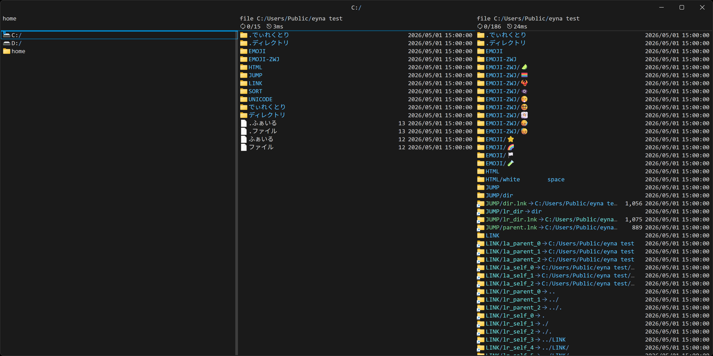
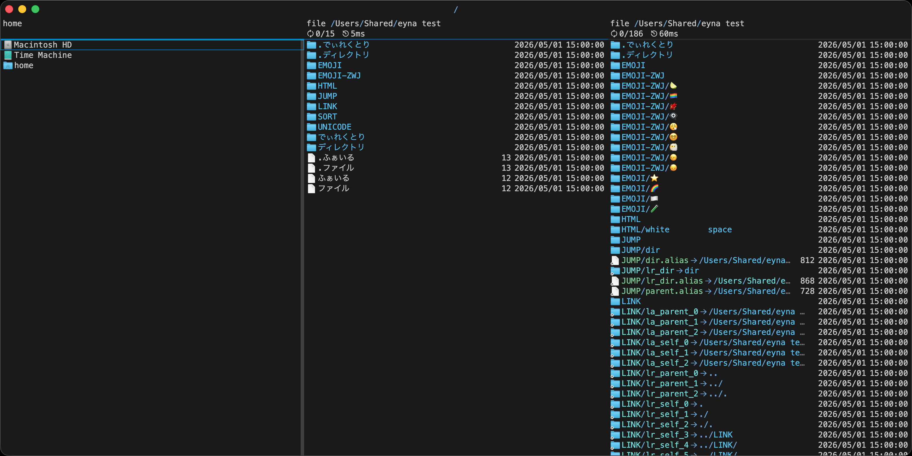

# eyna

Electron 製のキーボードファイラーです。  
Windows と Mac で同じファイラーを使いたかったので作りました。

ファイル操作には nodejs の fs を使用せず C++ addons で実装しています。

キー割り当ては [config/key.json](config/key.json) を参照してください。

## できること

- ファイル操作
  - 削除 (ゴミ箱)
  - コピー
  - 移動
  - リネーム
  - 複製
  - フォルダ作成
  - ファイル作成
  - シンボリックリンク作成
- 正規表現による再帰検索
- ビューア
  - アーカイブ (7z / rar / tar / tar.gz / tgz / tar.xz / txz / tar.zst / zip)
  - 画像 (gif / jpg / jpeg / png / webp)
  - 音声 (mp3 / m4a / ogg / wav / wave)
  - 動画 (mp4 / webm)
  - テキスト
  - バイナリ
  - diff
  - PDF
- リンク 解決
  - シンボリックリンク
  - ショートカット (Windows)
  - エイリアス (Mac)
- クラウドファイル 判定
  - FILE_ATTRIBUTE_RECALL_ON_DATA_ACCESS (Windows)
  - NSURLUbiquitousItemDownloadingStatusNotDownloaded (Mac)
- Git ステータス 表示
  - ブランチ名
  - ファイルの変更状態
- 双方向テキスト 対策

## 操作の考え方

- 一覧を複数並べて使います
- 操作対象の画面が active、相手先の画面が target です
  - `left` / `right` で active が隣へ移り、直前まで active だった画面が target になります
- コピー・移動などは、active のマーク (なければカーソル位置) を target のディレクトリへ行います
  - 上書きはしません。target に同名の項目があると、その項目は通知なくスキップされます
- キー割り当ては [config/key.json](config/key.json) です
  - `when` で場面 (`filer` / `viewer` / `modal`) を分け、`cmd` が処理名です
  - `list.extension` は `prm` で [extension/](extension) のスクリプトを呼びます

## スクリーンショット

### Windows

### Mac

## 注意事項

ファイル操作を行う都合上、アンチウィルスソフトウェアによっては誤検知される可能性があります。
基本的には問題ないはずですが、不安な場合は使用しないことをおすすめします。

Apple Silicon 環境で起動するには、`xattr` コマンドを使用して Apple Gate Keeper の対象外に設定する必要があります。
